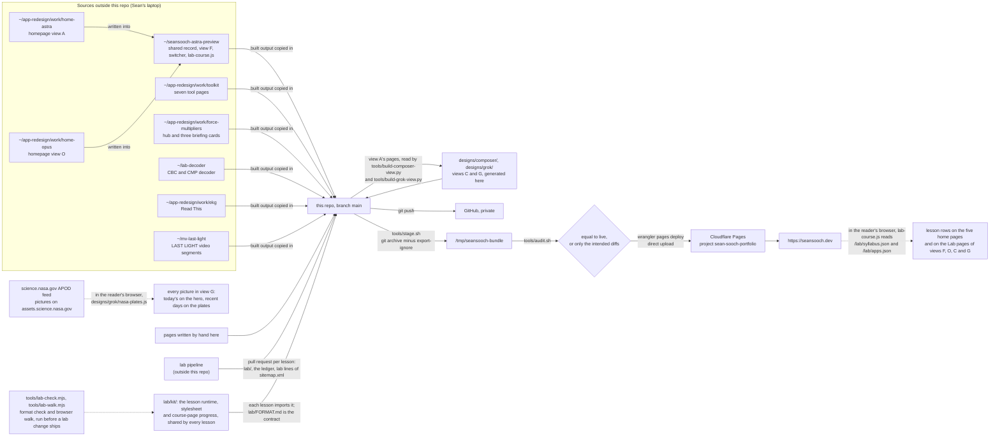

# Architecture

seansooch.dev is a static site: HTML, CSS, JavaScript and media, served as files. This repository has no build step, no
server and no dependencies to install. Branch `main` is the site.

## How it ships

- **Hosting.** Cloudflare Pages project `sean-sooch-portfolio`, production branch `main`, deployed by direct upload with
  wrangler from Sean's laptop. Cloudflare is not connected to GitHub. **Merging a pull request does not deploy.**
- **GitHub** is the record of what is live and the place changes are proposed. GitHub Pages is off and must stay off: it
  would serve the Markdown and `tools/` that the bundle leaves out. `CNAME` is left over from when it was on, and still
  ships because it always has.
- **The bundle** is a commit minus everything marked `export-ignore` in `.gitattributes` (Markdown, `tools/`, git
  plumbing). That file is the only definition of the difference between the repo and the site. Nothing ships from an
  uncommitted working tree, nothing ships from a commit that holds a symlink, and nothing ships from a commit in which a
  page asks for a shared asset by a stale `?v=` stamp: `tools/stage.sh` refuses all three.
- **The audit.** `tools/audit.sh` compares every served file in the bundle with the live site by hash (`_headers` and
  `_redirects` are consumed by Pages, not served, so their effect is checked by behaviour). Before a deploy its DIFF
  list should be exactly the files you meant to change; after, it should be empty.

## What is in here

| Path | What | Edit here? |
|---|---|---|
| `index.html`, `two-stories/` | Homepage and essay, view A (OpenAI Astra) | No. Generated. |
| `designs/fable/`, `designs/opus/` | The same two pages in views F and O, and each view's Lab course page (`lab/`) | No. Generated. |
| `designs/composer/` | View C (Cursor Composer 2.5, "The Live Stack", added 2026-10-27, redesigned the same day): the home page, the essay and the Lab page in the view's own console layout (a process rail on the left, the work stacked as panes), with its own markup, class names, type scale, colours and motion. The words, links and data hooks come from view A's `index.html` and `two-stories/index.html` and from view F's `designs/fable/lab/index.html`; the switcher head block (with its `?v=` stamps) and nav are copied from those pages | No. Generated by `tools/build-composer-view.py`, which writes only these three pages. Rerun it after view A or view F content changes (or after a restamp) and commit the result; a rerun on an unchanged tree changes nothing. Do not hand-edit: the next run overwrites it |
| `designs/grok/` | View G (Grok 4.7, "The Night Orbit", added 2026-10-27): the home page, the Two Stories essay, and the Lab course page. Generated by `tools/build-grok-view.py` from view A's pages; its views band and Vol. 03 row are read from view A's home page, so it lists the same views. A deep-space mission log in system fonts. Every picture is a NASA Astronomy Picture of the Day, chosen in the browser by `designs/grok/nasa-plates.js` (written by the same builder) from APOD's WordPress feed on science.nasa.gov: today's on the home hero, recent days on the plates, a fixed set of public-domain NASA days when the feed cannot be read. Check with `node tools/grok-nasa.walk.mjs <base>`. | No. Generated by `tools/build-grok-view.py`, which writes only this folder and this row. Rerun it after view A changes and commit the result; do not hand-edit |
| `design-switcher.css`, `design-switcher.js` | The fixed bar that switches views. Every page asks for them (and `lab-course.js`) by a content stamp, `?v=` plus the first 10 hex digits of the file's MD5 | No. Copied from the preview, then every view page restamped (the preview's `edition_views.switcher_head`) |
| `lab-course.js` | Draws lesson rows from the lab ledger on the five home pages and on the Lab pages of views F, O, C and G | No. Copied from the preview. |
| `antibiotic-coverage/`, `calculators/`, `clinical-calculators/`, `differentials/`, `lab-values/index.html`, `tccc/`, `toolkit/` | Field Toolkit, Edition 2 "Pocket Cards" | No. Generated. |
| `force-multipliers/` | Force Multipliers: a hub and three briefing cards (Graph vs Loop, Obsidian Reader, Anki), with their own stylesheet and script | No. Generated. |
| `lab-values/cbc-cmp/` | CBC and CMP decoder | No. Copied from `~/lab-decoder`. |
| `ekg/index.html` | Read This, Edition 2 | No. Generated. |
| `ekg/*.js`, `ekg/films/` | Read This data and chest films; `ekg/ARCHITECTURE.md` describes them | Yes, with care |
| `music/index.html`, `music/last-light/index.html`, `music/three-roads/index.html` | `/music/` is the Claudia Bench (anabology's films, kept as the reference) above the Music list (our songs); LAST LIGHT; The Glass (track 4 of Three Roads From Here). `/music/claudia-bench/` 301s to `/music/` | Yes |
| `music/last-light/media/` | HLS video segments (most of the repo's size) | No. Rendered elsewhere. |
| `music/films.js`, `music/music.css` | The shared player (reads the page's `<script id="films">` list, streams `media/<slug>/` beside the page) and stylesheet of `/music/` and `/music/three-roads/`. LAST LIGHT keeps its own | Yes |
| `music/media/<slug>/`, `music/three-roads/media/<slug>/` | One 720p HLS stream and poster per film, made by `tools/music-film.sh` (segments an H.264 720p master as is, re-encodes anything else); a song with no film is `song.m4a` + `cover.jpg` | No. Regenerate with `tools/music-film.sh`. |
| `videos/`, `screenshots/`, `*.pdf`, `favicon.svg` | Films, card images, papers | Yes |
| `lab/` | The Lab: one small app a day, its index and ledger (see The Lab below) | Yes |
| `drills/` | Drills: a hub and scored practice drills, separate from the Lab (see Drills below). R9, the Base-rate risk trainer, is the first | Yes |
| `_headers`, `_redirects`, `robots.txt`, `sitemap.xml` | Edge behaviour and crawl rules | Yes |
| `CNAME` | Left over from GitHub Pages; still ships | Leave it |
| `*.md`, `tools/`, `.gitattributes`, `.gitignore` | Never shipped | Yes |

A generated page is overwritten the next time its source is rebuilt, so a hand edit to one does not last. Its source is
on Sean's laptop, outside this repo:

- **Homepage, five views of one text.** The home page and essay of views A, F and O, the Lab course page of views F and O,
  the switcher and `lab-course.js` are assembled in `~/seansooch-astra-preview` and copied here. View A's content is built in `~/app-redesign/work/home-astra`; view O is built by
  `~/app-redesign/work/home-opus/build.py`, which writes into the preview; `build-designs.py` in the preview generates
  view F and stamps the shared record (`sources/editions.json`, `sources/corrections.json`) into views A and F, and the
  view O build applies the same record, so a fact changes in one place and agrees in every view. The record lists all
  five views; every views band, every count of views ("Five views") and the Vol. 03 row are made from that list. Views C
  and G are built here (`tools/build-composer-view.py`, `tools/build-grok-view.py`) from view A's built pages, their
  views band and Vol. 03 row included, so after copying view A in, rerun both builders. The preview's own
  `ARCHITECTURE.md` is the authority on the build order.
- **Field Toolkit.** `~/app-redesign/work/toolkit/build.py` writes the seven pages and `toolkit/pocket.css` from
  `src/<page>/index.html`.
- **Force Multipliers.** `~/app-redesign/work/force-multipliers/build.py` writes `force-multipliers/`: the hub and one
  briefing card per entry of its `BRIEFS` registry, each card being `src/<slug>/body.html` wrapped in the shared head
  and chrome, plus `brief.css` and `brief.js` copied unchanged from beside it. The section is drawn in the toolkit's
  Pocket Cards grammar and shares no file with it. A card's tab colour lives only in the registry (the build writes
  it on the page and on its hub card). The drawing on Graph vs Loop is one Graphviz file,
  `src/graph-vs-loop/graph.source.svg`, written twice: inline in the page (re-coloured by `brief.css`, stepped through
  by the page's own script) and as `force-multipliers/graph-vs-loop/delivery-graph.svg`. The build refuses to write a
  card whose script names an id the markup lacks, whose tour lights a name the drawing does not have, or whose check
  questions are malformed, and fails if any page links to the toolkit or to a site path it did not write. The section
  is a row of its own on every home page (5-4 under the smaller experiments in views A and F, and in views C and G,
  which take it from view A; an unnumbered Lesser works row in view O) and an entry in their system registry.
- **Read This.** `~/app-redesign/work/ekg/build.py` assembles `ekg/index.html` from its parts.
- **CBC and CMP decoder.** `lab-values/cbc-cmp/index.html` is a copy of `~/lab-decoder/index.html`.

To change a generated page from a pull request, describe the change and name the page. Sean applies it at the source.

### The course in every view

Three pages exist in every view, and the switcher moves between them: the home page, the Two Stories essay and the Lab
course page. A lesson is an app with one page, the same in every view.

| | View A (Astra) | View F (Fable 5.1) | View O (Opus 5.5) | View C (Composer 2.5) | View G (Grok 4.7) |
|---|---|---|---|---|---|
| Lab course page | `/lab/` (`lab/index.html`, the course in units, generated by `tools/lab-index.mjs`) | `/designs/fable/lab/` | `/designs/opus/lab/` | `/designs/composer/lab/` | `/designs/grok/lab/` |
| Where its lesson list comes from | Written into the page by `tools/lab-index.mjs` | Drawn in the browser by `lab-course.js` | Drawn in the browser by `lab-course.js` | Drawn in the browser by `lab-course.js` | Drawn in the browser by `lab-course.js` |

- **No generated page holds a lesson.** The Lab section of each home page and the Lab pages of views F, O, C, and G carry a row
  template in that view's own markup. `lab-course.js` reads `/lab/syllabus.json` and `/lab/apps.json` in the reader's
  browser and fills the template once per lesson, so a lesson the pipeline ships appears in every view that draws from the ledger, with no
  rebuild of a generated page. If the files cannot be read, or hold no lessons, the page keeps what it was served with:
  the home pages still link to the course, and those Lab pages point at the course.
- **The two ledger files are an interface.** `lab-course.js` reads `modules[].slug`, `title`, `description` and
  `drugClasses` from `lab/syllabus.json`, and `slug` and `date` from each entry of `lab/apps.json` (plus `title` and
  `description` for an app that is not in the syllabus). Renaming one of those fields empties the lesson rows on the
  generated home and Lab pages outside `lab/`, and a lab deploy's audit would not notice. The script trusts neither file: every value is set
  as text, never as markup; a slug that is not lowercase words joined by hyphens is dropped; a link is this site's
  origin plus `/lab/<slug>/`; an entry whose date is not a real day has not shipped.
- **`lab/index.html` carries the switcher.** This is the one exception to what The Lab section below says about that
  file. Three things in it come from the preview, not from the pipeline: the `data-design="astra"` attribute on
  `<html>`, and the two blocks between `design-switcher:start` and `design-switcher:end` comments (the assets in
  `<head>`, the bar before `</body>`). The pipeline's own copy of that page must hold the same three or its next sync
  removes them. From this repo's root, `python3 ~/seansooch-astra-preview/build-designs.py --stamp lab/index.html`
  puts them back and is safe to repeat.
- The opening paragraphs of the generated Lab pages of views F and O were copied from `/lab/` before the course grew units,
  goals and quizzes (2026-11-06); they are still true but do not mention those. They change at their sources
  (`sources/fable-lab.html` in the preview, `src/lab.template.html` in `~/app-redesign/work/home-opus`).
- `lab-course.js` ignores the syllabus's `units` and each module's `unit`: the other views list the lessons in order,
  without units, and link each to the same lesson page.

## The Lab

`lab/` is a course in core medicine: 21 lessons in six units, each a guided lesson plan with moving pictures. It is
written here, by hand or by the lab pipeline (which runs outside this repo and opens a pull request for each lesson).
Since 2026-11-06 this repo, not the pipeline, is the source of truth for the course page, its styles, its generator and
this section: the pipeline's bootstrap copies must be refreshed from here before it syncs again.

- **The course** is `lab/syllabus.json`: `units` (id, title, summary) and `modules` in teaching order (slug, title,
  one-line description, the drug classes and disease states each lesson animates, its `unit`). A unit's modules sit
  together. Sean reorders or edits it by hand; never rename a shipped lesson's slug. The pipeline builds the first module
  that is neither shipped (`lab/apps.json`) nor withdrawn (`lab/rejected.json`).
- **The course page** `/lab/` is `lab/index.html`, hand-written except the block between its `LAB:LIST` markers, which
  `node tools/lab-index.mjs` rewrites from the syllabus, the ledger and each lesson's `plan.json`: the course's facts, a
  map of the units with a dot per lesson, every unit with its lessons (time, steps, questions, what each builds on, its
  goals), the mixed review, and a table of each lesson's step numbers. The same script adds `/lab/` and each lesson to
  `sitemap.xml` and drops the entries of lessons no longer in the ledger. `lab/kit/course.js` draws the reader's own
  progress over it (bars, the map's dots, "pick up where you left off") and runs the mixed review: ten questions from the
  lessons the reader has started, each linked to the step that teaches it.
- **Every lesson follows `lab/FORMAT.md`**: a plan (goals, time, prerequisites), 12 to 22 steps of one idea and one
  picture each, the last stage "What changes it" with one step per drug class or disease state, a prediction before each
  of those changes plays, a quiz of 6 to 10 questions tied to the goals and to the steps that teach them, a summary
  (takeaways, the reader's score on each goal, every term the lesson defines, the next lesson; it prints on its own), a
  Clinical values tab and an Explore freely tab.
- **The kit** (`lab/kit/`) runs all of that, so a lesson holds only its words, pictures, model and reference tabs:
  `kit.js` (tabs, steps, the step rail, the picture player, predictions, quiz, summary, glossary, terms that light parts
  of a picture), `kit.css` (the one design system, including the shared vocabulary of the Clinical values and Explore
  tabs), `draw.js` (SVG helpers and the colour set), `quiz.js` (choices in a fixed shuffled order per question),
  `progress.js` (the reader's progress, in their browser only) and `course.js` (the course page). A picture is
  `render(t)` on a timeline from 0 to 1 (or a scene that mounts its SVG once and updates it), 480 units wide and at most
  420 tall, with type that reads at 12 px or more on a 375 px phone.
- **`lab/<slug>/`** is one lesson: `index.html`, `app.js` (an ES module that imports the kit and calls `lesson()`),
  `plan.json`, `clinical-values.json`, `style.css` (only its pictures' classes) and, where it has one, a model. Static
  files from this origin only, no third-party requests except Google Fonts, no data sent anywhere. Each opens with the
  site's shared top bar (the homepage's view A bar), whose CSS is part of `kit.css`; `/lab/` carries the same bar.
- **Caching.** `_headers` serves everything under `/lab/` with `Cache-Control: no-cache` (Pages'
  default for scripts and styles is four hours), because lesson pages ask for their files by plain
  names and are edited often. That holds on the `*.pages.dev` hosts; on seansooch.dev the
  Cloudflare zone's Browser Cache TTL (four hours, checked 2026-11-06) rewrites it to
  `max-age=14400` for scripts and styles, so until that setting is "Respect Existing Headers" an
  edited lesson script can reach a returning reader up to four hours late. The 21 lessons rebuilt
  on 2026-11-06 ask for `style.css?v=2`, `app.js?v=2` and `model.js?v=2` to retire older copies.
  `/lab/`'s own stylesheet is stamped `?v=` like the shared assets, and `tools/stage.sh` checks it.
- **Checks.** `node tools/lab-check.mjs` checks every lesson against the format (structure, the plan's schema, answer
  keys, that every goal is tested and every change has a prediction, no em dashes, nothing that looks like a dose).
  `node tools/lab-walk.mjs <served base> [slug ...]` walks every step of every lesson in installed Chrome at 1280 x 900
  and 375 x 553: one picture per step within its size, predictions holding the picture, no overlapping labels, no label
  under 12 px on the phone, no sideways scroll, a working quiz and summary, no console errors. It plants a defect first
  to prove its own detectors can fail. Neither runs in CI; run both before a lab change ships.
- `lab/apps.json` is the ledger of shipped lessons (slug, title, date, description, builder, reviewer, and `revisions`:
  later rebuilds, each with its date, what changed, builder and reviewer). `lab/rejected.json` lists lessons Sean turned
  down and why. A withdrawn lesson is deleted from `lab/`, the ledger, the index and the sitemap in the same pull request
  that records it there, so the pipeline never proposes it, or anything like it, again.
- Lab lessons are deployed automatically after checks (Sean approved this for `lab/` only): a lab deploy is cut from a
  pushed commit on `main` with `tools/stage.sh`, and is aborted if `tools/audit.sh` reports a difference outside `lab/`
  and the lab lines of `sitemap.xml`.
- Lab lessons are never AI-themed (no AI opponents, no "learns your habits", no frontier-AI topics, no machine learning
  as the gimmick), and games are optional rather than the default.
- Anything in the lab that touches medicine is educational, says it is not for clinical use, never gives drug doses,
  and never changes or restates the clinical values in the toolkit or Read This.
- Every lesson has a "Clinical values" tab (Sean's sign-off, 2026-10-07): typical adult reference ranges from Guyton &
  Hall, Costanzo, Boron & Boulpaep, OpenStax or a major guideline, each cited with its location, drawn as live range bars
  against the lesson's model, with the expected direction of change in each disease and drug state, and the note
  "Typical adult reference ranges; labs vary; not for clinical decisions." All of a lesson's values live in one file,
  `lab/<slug>/clinical-values.json`, so they can be audited in one place; the second-opinion reviewer must verify each
  against its source.

## Drills

`drills/` is its own section. It is not part of the Lab. Sean said on 2026-11-06 that the Lab is medicine only, and that a drill which is going to be published has to live in its own section. The hub is `/drills/`. Homepage rows and `sitemap.xml` are not part of this section: another pass adds them after review.

- Pages are static HTML, CSS and JavaScript from this origin only. The only third-party requests are Google Fonts. Nothing is sent to a server. A drill may store its session score in `localStorage`, and that call is wrapped in try/catch.
- Each Drills page copies the shared top bar the Lab lessons use: brand to `/`, then Work, Writing, Films, Editions, and The Lab to `/lab/`. The CSS for that bar is copied into the page, the same way a lesson appends it. The Lab link is not marked as the current page, because a drill is not a Lab lesson. The brand mark in the copied bar uses a hyphen. The lesson template uses an em dash there, and files in this section do not use em dashes or en dashes.
- Cases are fictional, and the pages say so. The banner reads "Fictional cases. Educational, not for clinical use." Drills give no drug doses.
- The hub lists one drill: R9, the Base-rate risk trainer, at `/drills/base-rates/`. The learner estimates positive predictive value, then sees a 2x2 table per 1,000 fictional patients, a 1,000-patient icon array, PPV, NPV, NNE and NNT, and a prevalence slider on a log scale from 0.1% to 50%. Expected values for the ten cases and the two worked checks live in `drills/base-rates/fixtures.json` as rationals. `node drills/base-rates/test.mjs` compares the page's math with that file. The fixture values were not produced by the page.
- R9 needs an independent check of the math and the wording before publication. The page does not claim physician sign-off or human validation.
- Drills are not on the automatic Lab deploy. Shipping this section, after that review, follows the site's normal sequence: commit, stage, audit, deploy, audit, push.

## Monitoring the Situation (moved)

For two days (2026-10-08 to 2026-10-09) this site had a Monitoring page in each view, at `/monitor/`,
`/designs/fable/monitor/` and `/designs/opus/monitor/`, reading a daily briefing from a Worker at
`feed.seansooch.dev`. It is now its own site, https://situation.seansooch.dev, with its own repository
(`seansooch-byte/monitoring-the-situation`), and nothing of it is left here except:

- **An app on the home pages.** Monitoring the Situation is a system like the others: a card in each view (Fig. 3-15
  in view F, row 15 in view A, Works 15 in view O), an entry in each view's host registry, and a `connect-src` entry
  in `_headers` for the browser probe. Those live in the homepage sources, not in this repo.
- **Six redirects** in `_redirects`, so every address the old page had answers with a 301 to the new site.

The view switcher is back to three pages per view (home, Two Stories, the Lab course). The `feed.seansooch.dev`
Worker is not part of this repo and nothing here reads it any more.

## Edge behaviour

- `_redirects` sends `/sims`, `/simulators`, `/cpr`, `/codeblue`, `/alignment` and `/alignment-simulator` to the
  simulators site, a separate Pages project, and the three old Monitoring addresses to situation.seansooch.dev (301).
  The three briefing cards were at `/toolkit/<slug>/` for a few hours on 2026-10-09; those addresses go to
  `/force-multipliers/<slug>/` (301).
- `_headers` marks every `*.pages.dev` host of this project `noindex`. Only the custom domain is indexable. Keep the file
  in every deploy; it never appears in the upload receipt.
- `_headers` also sets security headers on every path and host: HSTS (one year, no `includeSubDomains`, no `preload`),
  `nosniff`, `X-Frame-Options: DENY`, `Referrer-Policy`, a `Permissions-Policy`, and a **report-only**
  Content-Security-Policy that logs violations to the console and blocks nothing. Its `connect-src` names every host the
  homepage probes: a new probed host needs an entry there. Cloudflare injects Web Analytics
  (`static.cloudflareinsights.com`) into live HTML, so the policy allows that script too.
- `www.seansooch.dev` redirects to the apex by a Cloudflare Redirect Rule, not by anything in this repo.
- An unknown path answers **200 with the homepage**. A status code proves nothing about a deploy; compare bytes.

## Third-party requests at runtime

Google Fonts on most pages, and `hls.js` from cdn.jsdelivr.net (pinned by integrity hash) on `/music/`, `/music/last-light/` and `/music/three-roads/`.
The three pages of view G (`/designs/grok/`) read NASA's Astronomy Picture of the Day feed from science.nasa.gov (WordPress REST, no key) and load its pictures from assets.science.nasa.gov; `designs/grok/nasa-plates.js` keeps only days whose post and image are on those two hosts, and falls back to a fixed set of NASA days when the feed cannot be read.
Nothing else is loaded from another origin (the homepage host probes are requests whose responses are never read), and no page posts data anywhere.

## Other hosts

Most of the systems on the homepage (Step 2 CK, Detroit Sports, the simulators, the AGI tracker and the rest) are
separate Cloudflare Pages projects with their own sources. Read This, the Field Toolkit, Force Multipliers and Music
are paths on this origin; the rest live outside this repo. The homepage probes each host from the browser to show
whether it is up.

## Clinical content

The toolkit and Read This are reference and training tools written by a medical student. Several items carry a visible
"flagged for clinician review" note. A change to a clinical value, threshold, dose or grading rule needs Sean's sign-off
and goes in at the source, never in the generated page. The briefing cards of Force Multipliers are about
working methods (agent workflows, reading, spaced repetition) and state no clinical values; each cites its sources at
its foot.
