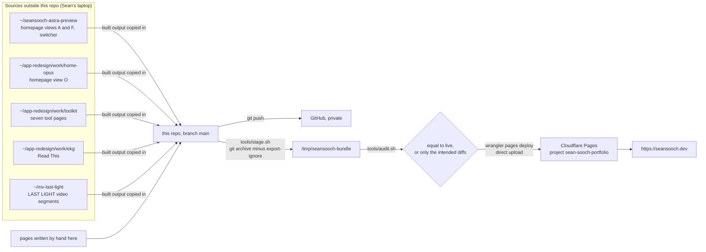

# Architecture

seansooch.dev is a static site: HTML, CSS, JavaScript and media, served as files. This repository has no build step, no
server and no dependencies to install. Branch `main` is the site.

## How it ships

- **Hosting.** Cloudflare Pages project `sean-sooch-portfolio`, production branch `main`, deployed by direct upload with
  wrangler from Sean's laptop. Cloudflare is not connected to GitHub. **Merging a pull request does not deploy.**
- **GitHub** is the record of what is live and the place changes are proposed. GitHub Pages is off and must stay off: it
  would serve the Markdown and `tools/` that the bundle leaves out. `CNAME` is left over from when it was on, and still
  ships because it always has.
- **The bundle** is a commit minus everything marked `export-ignore` in `.gitattributes` (Markdown, `tools/`, git
  plumbing). That file is the only definition of the difference between the repo and the site. Nothing ships from an
  uncommitted working tree, and nothing ships from a commit that holds a symlink: `tools/stage.sh` refuses both.
- **The audit.** `tools/audit.sh` compares every file in the bundle with the live site by hash. Before a deploy its DIFF
  list should be exactly the files you meant to change; after, it should be empty.

## What is in here

| Path | What | Edit here? |
|---|---|---|
| `index.html`, `two-stories/` | Homepage and essay, view A (OpenAI Astra) | No. Generated. |
| `designs/fable/`, `designs/opus/` | The same two pages in views F and O | No. Generated. |
| `design-switcher.css`, `design-switcher.js` | The fixed bar that switches views | No. Copied from the preview. |
| `antibiotic-coverage/`, `calculators/`, `clinical-calculators/`, `differentials/`, `lab-values/`, `tccc/`, `toolkit/` | Field Toolkit, Edition 2 "Pocket Cards" | No. Generated. |
| `ekg/index.html` | Read This, Edition 2 | No. Generated. |
| `ekg/*.js`, `ekg/films/` | Read This data and chest films; `ekg/ARCHITECTURE.md` describes them | Yes, with care |
| `music/index.html`, `music/last-light/index.html` | Music category and the LAST LIGHT page | Yes |
| `music/last-light/media/` | HLS video segments (most of the repo's size) | No. Rendered elsewhere. |
| `videos/`, `screenshots/`, `*.pdf`, `favicon.svg` | Films, card images, papers | Yes |
| `_headers`, `_redirects`, `robots.txt`, `sitemap.xml` | Edge behaviour and crawl rules | Yes |
| `*.md`, `tools/` | Never shipped | Yes |

A generated page is overwritten the next time its source is rebuilt, so a hand edit to one does not last. Its source is
on Sean's laptop, outside this repo:

- **Homepage, three views of one text.** Views A and F and the switcher come from `~/seansooch-astra-preview`
  (`build-designs.py`); view O comes from `~/app-redesign/work/home-opus` (`build.py`). All three read one shared record
  (`sources/editions.json`, `sources/corrections.json`), so a fact changes in one place and agrees in every view. That
  folder's own `ARCHITECTURE.md` is the authority on the build order.
- **Field Toolkit.** `~/app-redesign/work/toolkit/build.py` writes the seven pages and `toolkit/pocket.css` from
  `src/<page>/index.html`.
- **Read This.** `~/app-redesign/work/ekg/build.py` assembles `ekg/index.html` from four parts.

To change a generated page from a pull request, describe the change and name the page. Sean applies it at the source.

## Edge behaviour

- `_redirects` sends `/sims`, `/simulators`, `/cpr`, `/codeblue`, `/alignment` and `/alignment-simulator` to the
  simulators site, a separate Pages project.
- `_headers` marks every `*.pages.dev` host of this project `noindex`. Only the custom domain is indexable. Keep the file
  in every deploy; it never appears in the upload receipt.
- `www.seansooch.dev` redirects to the apex by a Cloudflare Redirect Rule, not by anything in this repo.
- An unknown path answers **200 with the homepage**. A status code proves nothing about a deploy; compare bytes.

## Other hosts

The systems on the homepage (Step 2 CK, Detroit Sports, the simulators, the AGI tracker and the rest) are separate
Cloudflare Pages projects with their own sources. None of them live in this repo. The homepage probes each host from the
browser to show whether it is up.

## Clinical content

The toolkit and Read This are reference and training tools written by a medical student. Several items carry a visible
"flagged for clinician review" note. A change to a clinical value, threshold, dose or grading rule needs Sean's sign-off
and goes in at the source, never in the generated page.
