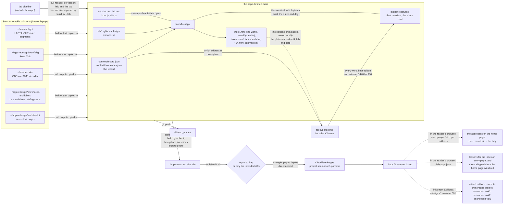

# Architecture

seansooch.dev is a static site: HTML, CSS, JavaScript and media, served as files. There is no server, and nothing to
install to serve it. Branch `main` is the site. The edition's own pages (the home page, the Two Stories paper, the
Lab's course page and the not-found page) are written by one script, `python3 tools/build.py` (standard library only),
from one record, and their output is committed like every other file.

**What the tools need.** Building, checking and staging need `python3` (3.9 or later), `git`, `bash` and `curl`; the
lab pipeline needs `python3` too, because `node tools/lab-index.mjs` runs the builder. The browser walks
(`tools/edition-walk.mjs`, `tools/lab-walk.mjs`) and the captures (`tools/plates.mjs`) need Node, an installed Chrome
and `playwright-core`, which they look for in `~/aa-main/node_modules` (set `PLAYWRIGHT_FROM` to another
`node_modules` folder to look elsewhere); the captures also need `cwebp` on the PATH. None of it ships.

## How it ships

- **Hosting.** Cloudflare Pages project `sean-sooch-portfolio`, production branch `main`, deployed by direct upload with
  wrangler from Sean's laptop. Cloudflare is not connected to GitHub. **Merging a pull request does not deploy.**
- **GitHub** is the record of what is live and the place changes are proposed. GitHub Pages is off and must stay off: it
  would serve the Markdown, `tools/` and `content/` that the bundle leaves out. `CNAME` is left over from when it was on,
  and still ships because it always has.
- **The bundle** is a commit minus everything marked `export-ignore` in `.gitattributes` (Markdown, `tools/`, `content/`,
  `plates/manifest.json`, git plumbing). That file is the only definition of the difference between the repo and the site.
  `tools/stage.sh` refuses to stage from an uncommitted working tree, from a commit that holds a symlink, from a commit
  in which a page asks for an asset by a stale `?v=` stamp, from a commit in which an edition page is not what
  `tools/build.py` writes (it runs `python3 -I tools/build.py --check`, which prints what is wrong and the command that
  fixes it), and from a commit whose `_redirects` sends readers to an address on another host that does not answer. It
  notes, and does not refuse, the one thing that is expected: the home page behind the ledger after a lesson's own
  deploy (see "The edition" below).
- **The audit.** `tools/audit.sh` compares every served file in the bundle with the live site by hash (`_headers` and
  `_redirects` are consumed by Pages, not served, so their effect is checked by behaviour; `404.html` is compared with
  the answer to a made-up path). Before a deploy its DIFF list should be exactly the files you meant to change; after,
  it should be empty.
- **Retiring an edition, in order.** (1) Tag the last commit of the old edition `vol-NN`. (2) Build its archive bundle
  from that tag. (3) Create the archive's Pages project and check the host it was given: a `pages.dev` name goes to
  whoever asks first, and a taken name comes back with a suffix, so the record and `_redirects` must name the host that
  was actually assigned. (4) Deploy the archive and verify it by content, with `X-Robots-Tag: noindex` on every path.
  (5) Only then deploy the new edition, whose `_redirects` and home page point at the archive. `tools/stage.sh` enforces
  the order: it will not stage while a redirect target does not answer. (6) Push `main` and the tag.

## The edition: one record, one builder

The site is redesigned at every new model class, and each edition is designed end to end by the model it is named for.
The current edition is **Vol. 04, "Side by Side"** (Claude Fable 5.2, November 2026). An edition is a renderer; the
record it renders outlives it.

- **`content/record.json` is the record**: every work (name, world, address, both tellings, figures, the editions it
  has had and where each is kept), the papers, the films, the volumes of this site with Vol. 03's five views, the
  sentences that have two tellings, and the counts. Edit it by hand, then run `python3 tools/build.py`.
  `content/two-stories.json` is the paper, word for word. Neither is served.
- **Counts are computed, never typed.** A sentence in the record asks for one with braces (`{Works}`, `{lines}`,
  `{units}`); the builder fills it from the record and the Lab's ledger, so two pages cannot disagree. An unknown
  brace stops the build. **The work is counted one way**: every work once, in its own world, in the lede, the directory
  and each world's heading. `{systems}` is only the works whose lines are counted (`counted: true`), and a sentence
  that uses it says so ("{lines} lines ... in {systems} of them"). The filter's world buttons carry no count, because
  a work shown in a second world (`also`) would be counted twice there. The counts that cannot be computed here (lines, files, questions) are recounted at each
  edition and kept in `counts`, each with a sentence saying what it is a count of.
- **Two tellings.** Every sentence that has a technical and a plain telling is in the page twice; the `data-voice`
  attribute on `<html>` shows one. Nothing is swapped by script, so the page reads the same with scripts off. A sentence
  with one telling lives in the record's `text` block; no sentence a reader sees is typed in the builder.
- **`tools/build.py` writes the edition's six files**: `index.html`, `record/index.html`, `two-stories/index.html`,
  `lab/index.html`, `404.html` and `sitemap.xml`. A second run changes nothing, on any Python from 3.9. `--lab` writes only the Lab page and the
  sitemap (what a lesson's own deploy changes). The sitemap's lines for sections built outside this repo are typed in
  the builder (`ELSEWHERE`).
- **What the builder refuses.** The record, the plates manifest, the syllabus, the ledger and each lesson's plan can be
  changed by a pull request or by the pipeline, so none of them is trusted to be well formed. Every string is escaped
  where it is printed; the only markup a sentence can carry is `**bold**`, and a paragraph of the paper may also carry
  `<b>` and `<a href>`. What becomes an id, an address or a file name is checked first: ids are plain lowercase words
  and no two things may want one anchor; an address is `https://` or a path on this site (one leading slash, no
  backslash, no space or control character, because a browser reads `//host` and `/\host` as another host); a film is
  an mp4 with a jpg poster under `/videos/`; a date is `2026`, `2026-11` or a day that exists; a plate has a plain
  name, whole-number sizes and the day it was taken; a unit id is a slug that is not one of the page's own anchors; and
  no two elements of a page may share an id (a film named `index-data` would be found in place of the page's own
  data, and the page script also looks its data up as `script#...` and follows an index entry only to an anchor or a
  path on this site). A record that fails stops the build with a sentence saying which. However it is started, the
  builder imports nothing from its own folder, so a file a pull request leaves in `tools/` is never run in place of
  the standard library. A ledger entry that is not a lesson (a slug that is
  not plain words, a day that does not exist, a title that is not text, no folder) is left out, and a plan's minutes,
  lists and goals are used only if they are what they should be.
- **`--check`: stale, or only behind.** `python3 tools/build.py --check` writes nothing, prints each page that is not
  what the builder writes, and exits 1 if any is stale. A Lab page or the sitemap that differs is put right by `--lab`.
  The home page is allowed one difference: lessons that shipped after it was built, because a lesson's own deploy
  rewrites only the Lab's pages. The check does not guess at that. It builds the home page again from this record,
  this design and a ledger cut down to the lessons the page on disk lists, and calls the page **behind** only if the
  result is byte for byte what is on disk. Such a page is correct as it stands, the reader's browser adds the newer
  lessons, and the next full build catches it up, so it is a note. Anything else is stale and needs a full build: an
  edited record or sheet, a changed builder, a page edited by hand, a lesson the page lists that was renamed or
  withdrawn. The Lab's build can never pass any of those.
- **The home page is the work; `/record/` is the site.** The home page holds the mast and its directory, Work,
  Writing, the AMA guidance and Films. The record page holds what is about the site itself: Editions, Counted and
  measured (with the status table), How it was made, and the printed Index. The bar names it as Record. The record page
  reads nothing from the Lab's ledger (no lesson count, no lesson typed into its index; `v4/site.js` adds every lesson
  to its printed index from the ledger), so a lesson's deploy never touches it. Anchors the home page gave up
  (`#editions`, `#record`, `#index`, `#about`, each volume and view, `#appa`, `#ch1`, `#ch2`, `#indexsec`) are listed
  in the home page's `<html data-moved>`, computed as the record page's anchors less the home page's: `v4/boot.js`
  sends a fresh load of `/#editions` on to `/record/#editions` before the first paint, and `v4/site.js` does the same
  when the hash changes on a home page already open. Every index entry, searched or printed, is addressed as a path
  (`/#work`, `/record/#vol3`), so the same index works from every page.
- **What the home page says of the Lab** is, for the same reason, only what stays true when a lesson is added: the
  lessons that have shipped, by unit, and how many (a number the reader's browser brings up to date). Hours, question
  counts, lesson numbers and lessons still to come are on the course page, which every lesson's deploy rebuilds. A
  revised lesson plan or a module added to the syllabus therefore does not touch the home page at all, and no sentence
  in the record can ask for a lesson count (`{lessons}` is not a brace the builder knows).
- **`v4/` is the edition's sheets and scripts**, hand-written: `site.css`, `lab.css` (only what the course page adds),
  `boot.js` (runs before the first paint so a returning reader's telling and theme never flash) and `site.js` (asking
  the addresses, the world chips, side by side, the films, the index, the Lab's ledger). The pages hold no inline style
  and no inline script that runs: the only inline blocks are JSON data (the addresses to ask, the index, the Lab's
  step table, the structured data). Each asset is asked for as `/v4/<file>?v=<first 10 hex of its MD5>`; the builder
  writes the stamp and `tools/stage.sh` refuses a stale one. The next edition gets `v5/`, so an archive of this one
  keeps working paths.
- **The USA theme.** A fourth appearance beside "as your device", light and dark: `data-theme="usa"` on `<html>`, kept
  under the same storage key. It is a set of tokens in `v4/site.css` (a dark ground, Old Glory blue for the bar, one
  red for the rule over each section, white ink) plus one strip under the bar that only shows while it is posted: two
  U.S. Air Force photographs, an F-22A and an F-35A, set side by side. The button in the bar posts it and, pressed
  again, gives back the theme the reader had; the colophon lists it with the others and, while it is posted, prints
  the theme's note and the imagery notice word for word. The photographs are named in the record (`theme.photos`: the
  Commons file, the part of the frame kept, the filter, the credit) and made by `python3 tools/photos.py` (Pillow,
  numpy, cwebp) into `v4/usa/`; they are lazy, so a reader who never posts the theme downloads nothing. Aircraft only:
  no photograph shows a person.
- **Plates.** Every capture on the page is taken by `node tools/plates.mjs` from the record's addresses with the
  installed Chrome (1440 by 900, light, reduced motion, naming itself as the ordinary Chrome it is, because some feeds
  refuse a headless one) and written twice as WebP into `plates/`, with `plates/manifest.json` saying which exist,
  from what address and on what day. The builder only uses plates the manifest lists, and dates each on the page from
  the manifest; a work without one has its name set in type instead. It opens only an `https://` address or one of
  this edition's own pages under `--base`. A retired volume and its views are captured from its archive, never from
  the live site. Three plates are of this edition's own pages (`vol4`, `lab` and the share image `plates/card.jpg`,
  which every page names as its `og:image`), so retake those last, after any visible change, and build again.
- **A plate that needs a note carries it.** A work's `plate_note` is drawn across the foot of each of its captures and
  printed in every caption and description of them. The handoff tracker has one ("Synthetic patients, no real data"):
  its plates show a board of patients, all of them seeded demo data, and side by side hides the sentence that says so.
- **Asking the addresses.** On load, the reader's browser sends one opaque `no-cors` request to each work's address,
  stops it as soon as the host answers, and prints the round trip wherever that work is named. It proves a host
  answered, not that the page was right, and the page says so. The request carries no cookies and no referrer. A new
  address needs a `connect-src` entry in `_headers`, and a test fails until it has one.
- **Checks.** `python3 -I tools/edition_test.py` (standard library) holds the build to this: a census that every work,
  kept edition, paper, film, volume, view, lesson and sentence of the record reaches a page; derived counts (the chips,
  "side by side", each world's kept editions, no count typed into a sentence); no em dash; unique ids and links that
  land; legacy anchors; every asset asked for by its stamp; every class styled or read; no inline script or style;
  outside links only to hosts the record names, and none to a host this site must never link (kept as hashes); every
  address the page asks allowed by the policy; contrast of every ink on both grounds in both themes; the paper word for
  word; the tree built, by any process. It also breaks things on purpose, in a copy of the tree: a record that cannot be
  set safely must stop the build (with the unbroken record as the control); a ledger, syllabus or plan that is not what
  it should be must put no markup on a page; and `--check` is walked through a lesson's own deploy, a revised lesson, a
  module added to the syllabus, an edited record, an edited sheet, a renamed or withdrawn lesson and a page edited by
  hand. `node tools/edition-walk.mjs <served base>` walks the pages in installed
  Chrome at 1280 x 900, 393 x 659 and 375 x 553: no script errors, no sideways scroll, every control doing what it
  says, a ledger that has moved on and is not to be trusted, and a planted defect to prove it can fail. Run both before
  an edition change ships.

To add a work: one entry in `works` (and a `connect-src` entry in `_headers`), `node tools/plates.mjs <id>`,
`python3 tools/build.py`, `python3 -I tools/edition_test.py`. Nothing else names a work, and no count needs editing.

### Earlier editions

Retired editions are kept, each frozen in its own Pages project with `X-Robots-Tag: noindex` on every path and no
`rel="canonical"` to the live site: `seansooch-vol1` (The Magazine, Claude Opus 4.7), `seansooch-vol2` (Triad × Vitals,
Claude Fable 5) and `seansooch-vol3` (five views of one text: Claude Fable 5.1, OpenAI Astra, Claude Opus 5.5, Cursor
Composer 2.5, Grok 4.7; retired 2026-11-09). The Vol. 03 archive holds the fifteen view pages, the switcher, and the
films, papers and ledger they load; app and lesson addresses there redirect to the live site. In this repo the five
views, the switcher, `lab-course.js` and the two view builders were removed when Vol. 04 was built; they are in history
at the commit tagged `vol-03`, and the sources of views A, F and O stay on Sean's laptop
(`~/seansooch-astra-preview`, `~/app-redesign/work/home-astra`, `~/app-redesign/work/home-opus`) as that edition's
build record. `_redirects` sends every `/designs/...` address to the same path in the Vol. 03 archive.

## What is in here

| Path | What | Edit here? |
|---|---|---|
| `content/` | The record and the paper (see above) | Yes. Then run `tools/build.py` |
| `index.html`, `record/index.html`, `two-stories/index.html`, `lab/index.html`, `404.html`, `sitemap.xml` | The edition's pages | No. Written by `tools/build.py` |
| `v4/` | The edition's stylesheets and scripts, the course page's sheet among them | Yes. Then run `tools/build.py` for the stamps |
| `plates/` | Captures of every work, kept edition and volume, and the share image `card.jpg` | No. Retake with `tools/plates.mjs` |
| `antibiotic-coverage/`, `calculators/`, `clinical-calculators/`, `differentials/`, `lab-values/index.html`, `tccc/`, `toolkit/` | Field Toolkit, Edition 2 "Pocket Cards" | No. Generated. |
| `force-multipliers/` | Force Multipliers: a hub and three briefing cards (Graph vs Loop, Obsidian Reader, Anki), with their own stylesheet and script | No. Generated. |
| `lab-values/cbc-cmp/` | CBC and CMP decoder | No. Copied from `~/lab-decoder`. |
| `ekg/index.html` | Read This, Edition 2 | No. Generated. |
| `ekg/*.js`, `ekg/films/` | Read This data and chest films; `ekg/ARCHITECTURE.md` describes them | Yes, with care |
| `music/index.html`, `music/last-light/index.html`, `music/three-roads/index.html` | `/music/` is the Claudia Bench (anabology's films, kept as the reference), then the Fable 5.2 section (a bench film made by that model), above the Music list (our songs); LAST LIGHT; The Glass (track 4 of Three Roads From Here). `/music/claudia-bench/` 301s to `/music/` | Yes |
| `music/last-light/media/` | HLS video segments (most of the repo's size) | No. Rendered elsewhere. |
| `music/films.js`, `music/music.css` | The shared player: drives every `.bench` block on a page (each its own video, tabs, note and `<script class="films">` list; `#<slug>` opens the bench holding it; playing one pauses the rest), streams `media/<slug>/` beside the page and stylesheet of `/music/` and `/music/three-roads/`. LAST LIGHT keeps its own | Yes |
| `music/media/<slug>/`, `music/three-roads/media/<slug>/` | One 720p HLS stream and poster per film, made by `tools/music-film.sh` (segments an H.264 720p master as is, re-encodes anything else); a song with no film is `song.m4a` + `cover.jpg` | No. Regenerate with `tools/music-film.sh`. |
| `videos/`, `*.pdf`, `favicon.svg` | Films and their posters, papers, the site's mark | Yes |
| `screenshots/` | Share images that the tool pages and Read This name in their `og:image` | Yes |
| `lab/` | The Lab: the course, its kit and its lessons (see The Lab below) | Yes, except `lab/index.html` |
| `_headers`, `_redirects`, `robots.txt` | Edge behaviour and crawl rules | Yes |
| `CNAME` | Left over from GitHub Pages; still ships | Leave it |
| `*.md`, `tools/`, `content/`, `plates/manifest.json`, `.gitattributes`, `.gitignore` | Never shipped | Yes |

A generated page is overwritten the next time its source is rebuilt, so a hand edit to one does not last. The edition's
pages are generated here, from `content/`. The others have their source on Sean's laptop, outside this repo:

- **Field Toolkit.** `~/app-redesign/work/toolkit/build.py` writes the seven pages and `toolkit/pocket.css` from
  `src/<page>/index.html`.
- **Force Multipliers.** `~/app-redesign/work/force-multipliers/build.py` writes `force-multipliers/`: the hub and one
  briefing card per entry of its `BRIEFS` registry, each card being `src/<slug>/body.html` wrapped in the shared head
  and chrome, plus `brief.css` and `brief.js` copied unchanged from beside it. The section is drawn in the toolkit's
  Pocket Cards grammar and shares no file with it. A card's tab colour lives only in the registry (the build writes
  it on the page and on its hub card). The drawing on Graph vs Loop is one Graphviz file,
  `src/graph-vs-loop/graph.source.svg`, written twice: inline in the page (re-coloured by `brief.css`, stepped through
  by the page's own script) and as `force-multipliers/graph-vs-loop/delivery-graph.svg`. The build refuses to write a
  card whose script names an id the markup lacks, whose tour lights a name the drawing does not have, or whose check
  questions are malformed, and fails if any page links to the toolkit or to a site path it did not write.
- **Read This.** `~/app-redesign/work/ekg/build.py` assembles `ekg/index.html` from its parts.
- **CBC and CMP decoder.** `lab-values/cbc-cmp/index.html` is a copy of `~/lab-decoder/index.html`.

To change one of those from a pull request, describe the change and name the page. Sean applies it at the source.

## The Lab

`lab/` is a course in core medicine: guided lessons in units, each a lesson plan with moving pictures. It is written
here, by hand or by the lab pipeline (which runs outside this repo and opens a pull request for each lesson). This repo,
not the pipeline, is the source of truth for the course page, its sheet (`v4/lab.css`), its generator and this section:
the pipeline's bootstrap copies must be refreshed from here before it syncs again. On 2026-11-07 a sync from an older
bootstrap replaced the course page on the live site. Now `tools/stage.sh` refuses to stage a Lab page that is not the
builder's, the course page's sheet lives outside `lab/`, and `tools/lab-check.mjs` names what such a sync leaves behind
(a `lab/lab.css`, or a `tools/lab-index.mjs` that is not the wrapper).

- **The course** is `lab/syllabus.json`: `units` (id, title, summary) and `modules` in teaching order (slug, title,
  one-line description, the drug classes and disease states each lesson animates, its `unit`). A unit's modules sit
  together. Sean reorders or edits it by hand; never rename a shipped lesson's slug. The pipeline builds the first module
  that is neither shipped (`lab/apps.json`) nor withdrawn (`lab/rejected.json`).
- **The course page** `/lab/` is one of the edition's pages. `tools/build.py` writes all of `lab/index.html` from the
  syllabus, the ledger and each lesson's `plan.json` and steps: the course's facts, a map of the units with a dot per
  lesson, every unit with its lessons (time, steps, questions, what each builds on, its goals), the mixed review, and a
  table of each lesson's step numbers. A shipped lesson the syllabus does not place is never dropped: it is numbered
  after the placed ones, has its dot on the map under "Newest" and its row under "Added since the units were set"
  (`#more`). `node tools/lab-index.mjs` still exists because the pipeline runs it after adding a lesson: it calls
  `python3 -I tools/build.py --lab`, which writes the Lab page and the sitemap and nothing else, so a lab change still
  touches only `lab/` and the sitemap. `lab/kit/course.js` draws the reader's own progress over the page (bars, the
  map's dots, "pick up where you left off") and runs the mixed review. What it reads from the page is a contract: a
  `.lesson[data-slug][data-steps][data-quiz]` row with a `.no` (the lesson's number, two digits), an `h3` and a
  `[data-lab-progress]` holding `.bar i` and `.state`; a `[data-lab-dot]` per lesson, with a `title`;
  `[data-lab-resume]`; `[data-lab-review]` holding `[data-lab-review-start]`, inside `#review`; and the `#lab-steps`
  table. `v4/lab.css` styles only what the course page adds to the edition's sheet.
- **The ledger is an interface, and it is not trusted.** The home page's Lab outline is written at build time, and
  `v4/site.js` then reads `/lab/apps.json` in the reader's browser and adds any lesson shipped since (to the outline
  and to each place the lesson count is printed), so a lesson the pipeline ships shows on the home page without a
  rebuild. The printed index on `/record/` has no lesson typed into it: the same script adds every lesson there, in its
  alphabetical place. The index a reader searches (the "/" palette on every page) has no lesson
  typed into it at all: it reads the same ledger the first time it opens, which is why a new lesson leaves the paper
  and the not-found page byte for byte as they were. Both the builder and the script take only a slug that is plain
  words, a date that is a real day, and a title as text, never as markup.
- **Every lesson follows `lab/FORMAT.md`**: a plan (goals, time, prerequisites), 12 to 22 steps of one idea and one
  picture each, the last stage "What changes it" with one step per drug class or disease state, a prediction before each
  of those changes plays, a quiz of 6 to 10 questions tied to the goals and to the steps that teach them, a summary
  (takeaways, the reader's score on each goal, every term the lesson defines, the next lesson; it prints on its own), a
  Clinical values tab and an Explore freely tab. **One lesson does not yet**: `adh-water-balance`, shipped by the
  pipeline on 2026-11-07, is not in the syllabus and not on the kit (its own `js/` and `data/` folders, and its own
  copy of the top bar's CSS). `tools/lab-check.mjs` reports it until it is placed in a unit and rebuilt on the kit;
  the course page lists it as lesson 22, under "Added since the units were set".
- **The kit** (`lab/kit/`) runs all of that, so a lesson holds only its words, pictures, model and reference tabs:
  `kit.js` (tabs, steps, the step rail, the picture player, predictions, quiz, summary, glossary, terms that light parts
  of a picture), `kit.css` (the lessons' own design system, including the shared vocabulary of the Clinical values and
  Explore tabs), `draw.js` (SVG helpers and the colour set), `quiz.js` (choices in a fixed shuffled order per question),
  `progress.js` (the reader's progress, in their browser only) and `course.js` (the course page). A picture is
  `render(t)` on a timeline from 0 to 1 (or a scene that mounts its SVG once and updates it), 480 units wide and at most
  420 tall, with type that reads at 12 px or more on a 375 px phone. The lessons are an app with an edition of its own:
  a new site edition restyles the course page, not the lessons.
- **`lab/<slug>/`** is one lesson: `index.html`, `app.js` (an ES module that imports the kit and calls `lesson()`),
  `plan.json`, `clinical-values.json`, `style.css` (only its pictures' classes) and, where it has one, a model. Static
  files from this origin only, no third-party requests except Google Fonts, no data sent anywhere. Each opens with a
  top bar that names the site ("Sean Sooch", no edition number, so an edition never has to touch a lesson) and links
  `/#work`, `/#writing`, `/#films`, `/#editions` and `/lab/`; its CSS is part of `kit.css`. `/#editions` now lives at
  `/record/#editions`, and the home page sends it on (see the edition above), so no lesson needs rebuilding; the
  template should link `/record/#editions` the next time it is touched. The pipeline builds a new lesson's bar from
  its own template (`templates/site-top-lesson.html`, outside this repo), which has to match. The home page also keeps
  the older anchors (`#ch3`, `#ch4`, `#appb`) that a lesson built from an old template would link, and sends `#appa`
  on with the rest of Editions.
- **Caching.** `_headers` serves everything under `/lab/` with `Cache-Control: no-cache` (Pages' default for scripts and
  styles is four hours), because lesson pages ask for their files by plain names and are edited often. That holds on
  the `*.pages.dev` hosts; on seansooch.dev the Cloudflare zone's Browser Cache TTL (four hours, checked 2026-11-06)
  rewrites it to `max-age=14400` for scripts and styles, so until that setting is "Respect Existing Headers" an edited
  lesson script can reach a returning reader up to four hours late. Lessons ask for `style.css?v=2`, `app.js?v=2` and
  `model.js?v=2` to retire older copies; bump the number when one changes. The course page's own sheet is
  `/v4/lab.css`, stamped like the edition's other assets.
- **Checks.** `node tools/lab-check.mjs` checks every lesson against the format (structure, the plan's schema, answer
  keys, that every goal is tested and every change has a prediction, no em dashes, nothing that looks like a dose).
  `node tools/lab-walk.mjs <served base> [slug ...]` walks every step of every lesson in installed Chrome at 1280 x 900
  and 375 x 553: one picture per step within its size, predictions holding the picture, no overlapping labels, no label
  under 12 px on the phone, no sideways scroll, a working quiz and summary, no console errors. It plants a defect first
  to prove its own detectors can fail. Neither runs in CI; run both before a lab change ships.
- `lab/apps.json` is the ledger of shipped lessons (slug, title, date, description, builder, reviewer, and `revisions`:
  later rebuilds, each with its date, what changed, builder and reviewer). `lab/rejected.json` lists lessons Sean turned
  down and why. A withdrawn lesson is deleted from `lab/` and the ledger in the same pull request that records it there,
  and the next build drops it from the course page and the sitemap, so the pipeline never proposes it, or anything like
  it, again. A few lab changes are not lab-only, because the home page prints what they change: withdrawing a lesson,
  renaming one, moving one to another unit (placing a lesson the syllabus had not placed is that), and renaming a
  unit. Each needs a full build (`python3 tools/build.py`) and is deployed by hand; `tools/stage.sh` refuses until it
  has one.
- Lab lessons are deployed automatically after checks (Sean approved this for `lab/` only): a lab deploy is cut from a
  pushed commit on `main` with `tools/stage.sh`, and is aborted if `tools/audit.sh` reports a difference outside `lab/`
  and the lab lines of `sitemap.xml`. That is why a lesson's own deploy never rebuilds the home page: `tools/stage.sh`
  notes that it is behind the ledger, the reader's browser adds the lesson, and the next full build catches it up.
- The Lab is medicine only. Anything else that ships gets its own section of the site.
- Lab lessons are never AI-themed (no AI opponents, no "learns your habits", no frontier-AI topics, no machine learning
  as the gimmick), and games are optional rather than the default.
- Anything in the lab that touches medicine is educational, says it is not for clinical use, never gives drug doses,
  and never changes or restates the clinical values in the toolkit or Read This.
- Every lesson has a "Clinical values" tab (Sean's sign-off, 2026-10-07): typical adult reference ranges from Guyton &
  Hall, Costanzo, Boron & Boulpaep, OpenStax or a major guideline, each cited with its location, drawn as live range bars
  against the lesson's model, with the expected direction of change in each disease and drug state, and the note
  "Typical adult reference ranges; labs vary; not for clinical decisions." All of a lesson's values live in one file,
  `lab/<slug>/clinical-values.json`, so they can be audited in one place; the second-opinion reviewer must verify each
  against its source.

## Field Notes (moved)

From 2026-11-13 to 2026-11-14 this site had Field Notes at `/notes/`: one post a day by Soochiebot, a program set to
sound like Sean, from Monitoring the Situation's record. It moved to the situation as its Newsletter, a letter a day
beside the Paper (`contract/NEWSLETTER.md` in that repo), and its one post is Newsletter No. 1 there. Here it is two
redirects in `_redirects`, so every address it had answers at https://situation.seansooch.dev/newsletter/, day for day.

## Monitoring the Situation (moved)

For two days (2026-10-08 to 2026-10-09) this site had a Monitoring page. It is now its own site,
https://situation.seansooch.dev, with its own repository (`seansooch-byte/monitoring-the-situation`). Here it is a work
in the record like any other, a `connect-src` entry in `_headers`, and six redirects in `_redirects` so every address
the old page had answers with a 301 to the new site.

## Edge behaviour

- `_redirects` sends `/sims`, `/simulators`, `/cpr`, `/codeblue`, `/alignment` and `/alignment-simulator` to the
  simulators site, a separate Pages project; the old Monitoring addresses to situation.seansooch.dev (301); every
  `/designs/<view>/...` address to the same path in the Vol. 03 archive (301); and the three briefing cards' one-day
  addresses under `/toolkit/` to `/force-multipliers/<slug>/` (301). Pages applies redirects before files and takes the
  first rule that matches, so the Monitoring rules stay above the `/designs/` ones.
- `_headers` marks every `*.pages.dev` host of this project `noindex`. Only the custom domain is indexable. Keep the file
  in every deploy; it never appears in the upload receipt.
- `_headers` also sets security headers on every path and host: HSTS (one year, no `includeSubDomains`, no `preload`),
  `nosniff`, `X-Frame-Options: DENY`, `Referrer-Policy`, a `Permissions-Policy`, and a **report-only**
  Content-Security-Policy that logs violations to the console and blocks nothing. Its `connect-src` names every host the
  home page asks: a new address needs an entry there. The policy also allows Cloudflare Web Analytics' two hosts, for
  when it is switched on; on 2026-11-09 live HTML carried no beacon (Cloudflare adds only a challenge script and a
  hidden link to each page, both from this origin, and `tools/audit.sh` removes them before it compares).
- `www.seansooch.dev` redirects to the apex by a Cloudflare Redirect Rule, not by anything in this repo.
- **An unknown path answers 404 with `404.html`** (since Vol. 04; before it, Pages answered 200 with the home page). A
  status code still proves little about a deploy: compare bytes, which is what `tools/audit.sh` does.

## Third-party requests at runtime

Google Fonts on most pages, and `hls.js` from cdn.jsdelivr.net (pinned by integrity hash) on `/music/`,
`/music/last-light/` and `/music/three-roads/`. Nothing else is loaded from another origin (the home page's requests to
each address are opaque and never read), and no page posts data anywhere.

## Other hosts

Most of the works on the home page (Step 2 CK, Detroit Sports, the simulators, the AGI tracker and the rest) are
separate Cloudflare Pages projects with their own sources. Read This, the Field Toolkit, Force Multipliers, Music and
the Lab are paths on this origin; the rest live outside this repo. Each app keeps editions of its own: the record lists
them, and a retired edition stays online at its own address.

## Clinical content

The toolkit and Read This are reference and training tools written by a medical student. Several items carry a visible
"flagged for clinician review" note. A change to a clinical value, threshold, dose or grading rule needs Sean's sign-off
and goes in at the source, never in the generated page. The briefing cards of Force Multipliers are about
working methods (agent workflows, reading, spaced repetition) and state no clinical values; each cites its sources at
its foot. A claim on the home page about how a work was checked is a claim like any other: it is in the record, and it
is checked against that work's own records when the edition is.
