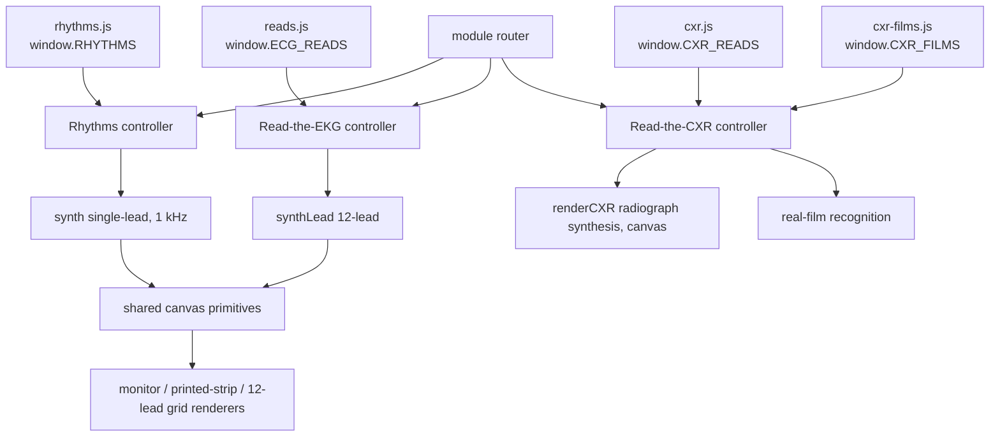

# Read This - Architecture

A browser tool for clinical pattern interpretation, built on one principle: **read it the same way every time.** Clinical truth lives in data; rendering never improvises morphology.

**Edition 2 "Reading Room" (Claude Opus 5.5, 2026-09-22):** new UI only. Every study is three zones: WORKLIST (pick the rhythm, case or film), LIGHTBOX (the strip, 12-lead or film), REPORT (the read, dictated line by line; finished steps stay written). Dark room by default, "room lights" light mode. The engine code is carried over verbatim from Edition 1 (only the canvas label font changed, JetBrains Mono to DM Mono). Edition 1 is frozen at ekg-v1.pages.dev. Build source for the page: `~/app-redesign/work/ekg/` (part1 shell + Edition 1 engines + part3 UI, assembled by build.py).

Deployed at `seansooch.dev/ekg/` (Cloudflare Pages project `sean-sooch-portfolio`).

## Modules

| Module | Status | Purpose |
|---|---|---|
| **Rhythms** | shipped | 28 sourced rhythm strips, Learn + Quiz, single-lead monitor/printed-strip rendering |
| **Read the EKG** | shipped | Systematic 12-lead interpretation: a fixed 8-step algorithm (rate → rhythm → axis → intervals → chambers → ischemia/infarct → culprit artery → impression), guided-reveal + scored active-recall, MI localization by territory. 14 realistic multi-finding cases drill every step. |
| **Read the CXR** | shipped | Same fixed-order discipline applied to chest X-ray: an "outside-in" 8-step read (adequacy → periphery → airway → lungs → heart/mediastinum → diaphragm → lines → impression). The systematic-read *drill* uses a schematic SVG engine (findings rendered from data); a *recognition* mode uses 5 real, license-cleared films with a toggle between "spot the finding" (MCQ) and "run the read" (full 8-step) over the same film. |

## Files

| File | Role |
|---|---|
| `index.html` | Shell, all CSS, module router, the three study controllers (rhythm study/quiz; one shared `makeReader` for the 12-lead and chest-film 8-step reads; real-film spot mode), shared canvas primitives, single-lead engine (Edition 2), 12-lead engine, CXR radiograph engine (Edition 2) |
| `rhythms.js` | `window.RHYTHMS` - 28 rhythm objects (clinical criteria + single-lead render params). Source of truth for the Rhythms module (every render flag is honoured by the Edition 2 strip engine). |
| `reads.js` | `window.ECG_READS` - `{ algorithm, teaching, cases }`. Source of truth for the Read the EKG module: the fixed step list, axis/lead/MI teaching content, and sourced 12-lead cases (render params + answer keys). |
| `cxr.js` | `window.CXR_READS` - `{ algorithm (8 outside-in steps), teaching, cases }`. Source of truth for the Read the CXR schematic drill: the fixed step list, RIPE/CTR/sign teaching, and multi-finding cases (schematic `render` params + answer keys). |
| `cxr-films.js` | `window.CXR_FILMS` - manifest of 5 real, license-cleared films (bundled under `films/`) for recognition mode. Each entry carries `src`, finding, recognition prompt/options, full 8-step answer key, and **attribution + license + source URL**. All films are CC0 or CC-BY-SA (Wikimedia Commons). |

## Engine layers

Calibration is fixed and honored everywhere: **25 mm/s, 10 mm/mV** (1 small box = 0.04 s / 0.1 mV).

```
gauss / setupCanvas / gridPaper   shared primitives (Gaussian waves, DPR canvas, ECG paper)
   |
   +-- synth(rhythm, seconds)  single-lead synthesis at 1 kHz (Rhythms module, Edition 2) -> { sig, beats, spikes }
   |
   +-- synthLead(case, lead)   12-lead synthesis (Read the EKG module, Edition 1) -> Float32Array per lead
```

### Rhythm strip engine (Edition 2, 2026-09-23; source `~/app-redesign/work/ekg/part2-rhythm.js`)
- A beat is built from QRS **vertices** (onset, q, R, S, J; one shape per `qrs.morph`) joined by straight slopes, plus
  asymmetric raised-cosine P and T waves; the whole trace is then smoothed with a 3 ms Gaussian (5 ms for VF and
  torsades). PR = P onset to QRS onset from the data; QT from Bazett (QTc 0.40 s); `t.discordant` puts T opposite
  the dominant QRS deflection; `p.pseudo` adds a pseudo-S (retrograde P); `fusionBeats` gives AIVR an occasional
  P plus intermediate QRS. Sinus rhythms carry about 1.5% heart-rate variability; every strip has slow baseline
  wander and a little muscle noise. Seeded by rhythm id, so a strip is repeatable.
- Rhythm-specific signals: fibrillatory waves (oscillators at 5.6 to 7.5 Hz), inverted sawtooth flutter locked to
  the conduction ratio, second-degree block by group (Wenckebach lengthens then drops; Mobitz II drops with a
  constant PR), complete block with independent P and escape timelines, compensatory versus non-compensatory
  pauses, torsades as a continuously twisting envelope, VF as drifting oscillators with no complexes, and pacing
  spikes 2 ms wide added after smoothing.
- Printed strip: 1 mV x 200 ms calibration pulse, exactly 6 s of rhythm, 3-second marks, lead and settings printed,
  and **calipers** (drag to read ms, rate and small boxes). Monitor: erase-bar sweep over a 120 s buffer, phosphor
  glow, beat indicator; no HR readout, because rate is part of the quiz.
- `lab_rhythm.py` renders all 28 strips and measures the rate from the SIGNAL (an R-peak detector, not the
  engine's annotations) against the data; it must say ok for every organized rhythm.

### 12-lead synthesis (accuracy-critical)
- **Limb leads** (I, II, III, aVR, aVL, aVF) are frontal-plane projections. Net QRS deflection scales with `cos(axisDeg − leadAngleDeg)` using the canonical hexaxial angles (I 0, II +60, III +120, aVR −150, aVL −30, aVF +90). A positive projection renders an R-dominant complex; a negative projection flips to an rS/QS. This makes axis deviation render correctly and aVR always predominantly negative, by construction.
- **Precordial leads** (V1–V6) are horizontal-plane and not derivable from the frontal axis. They use an R-wave-progression amplitude profile (rS in V1 → transition V3–V4 → qR in V6). Per-case overrides support tall-R patterns (e.g. posterior MI).
- **ST segment** elevation/depression is a per-lead baseline offset (mV) applied between QRS end and T onset, with reciprocal changes encoded explicitly in the case data, not inferred.
- T-wave polarity follows QRS direction by construction: limb-lead T tracks the sign of the frontal-plane projection (so aVR is concordantly inverted), and precordial T comes from a fixed `PRECORDIAL_T` profile (V1 inverted by default). ST shift adds to T amplitude so hyperacute T waves emerge with elevation.

### Rhythm temporal model (drives the rhythm + interval steps)
- Beat timing is generated by `beatList(case, seconds)` per rhythm type: sinus/junctional/ventricular are regular at the case rate (P present only for sinus); `afib` is irregularly irregular with no P (deterministic jitter); `aflutter` fires at `flutterRate / conduction` (e.g. 300/2 → 150). Every lead is synthesized independently, so timing is seeded by `mulberry32(caseSeed(case))` - all 12 cells and the rhythm strip share identical beat centers and stay vertically aligned (true simultaneity).
- Baseline rhythm artifacts are per-lead scaled, not global: `addFib` (fibrillatory baseline, `FIB_SCALE` peaks in V1) and `addFlutter` (sawtooth, `FLUTTER_SCALE` peaks in II/III/aVF). This matches where each pattern is actually most visible.
- Wide-QRS morphology (`qrsMorph:'wide'` → `drawComplex` `morph:'wide'`) renders a slurred, monophasic-dominant complex with a discordant T, used for VT and bundle branch block. Width comes from `qrsWidth` (ms).
- Chamber findings reuse existing machinery: LVH/RVH are expressed purely through per-case `rDom` precordial overrides + `axisDeg` (no new code); atrial enlargement is `chamber:'rae'`, which renders a tall peaked P. Interval findings (`pr`, `qrsWidth`, `qt`) drive the intervals step and measure correctly with calipers at the fixed calibration.

### CXR radiograph engine (Edition 2, 2026-09-23; separate from the ECG engines)
The chest film is **synthesized as a radiograph on a canvas**, replacing Edition 1's schematic SVG. A radiograph is a
projection, so `renderCXR(container, case)` builds an **attenuation field** (600 x 720, about 16.7 px per cm) and
develops it like film: soft tissue (neck, shoulders, chest wall, thicker centrally) minus lung air (deeper laterally
and basally), plus the mediastinum and heart (width = `ctr x thoracic width`, about 1/3 right : 2/3 left of the
midline, with SVC, aortic knob, aortopulmonary window, pulmonary artery, LA appendage and LV contours), descending
aorta, hila, a trachea and main bronchi of air (deviation from `trachea`), spine (bodies, pedicles, spinous
processes), 12 ribs per side with cortical rims (posterior arcs, fainter anterior ribs; 10 posterior ribs above the
dome on a good inspiration), clavicles, scapulae (lateral on PA, over the lungs on AP), humeral heads, a seeded
branching vessel tree clipped to aerated lung, parenchymal mottle, diaphragm domes with deep costophrenic recesses,
the gastric bubble with an air-fluid level, and the lead R marker ("AP PORTABLE" on AP films). Development: 3-pass
box blur (unsharpness), quantum mottle, a sigmoid characteristic curve (penetration shifts it).
Findings are drawn only when present in `case.render`, and because density adds, their signs are physical:
`consolidation` (lobar, fluffy above, air bronchograms, silhouettes its `silhouette` border), `effusion` (meniscus,
erases the dome and angle), `pneumothorax` (visceral pleural line, no markings beyond it; tension collapses the lung
onto the hilum, depresses and flattens the dome, widens the rib spaces), `edema` (upper-lobe diversion, perihilar
haze, Kerley B lines, cuffing), `freeAir`, `mass`, `subcutaneousEmphysema`, `mediastinum` shift or widening,
`rotation` (spinous processes and clavicular heads move opposite ways), `inspiration`, `projection`, `lines`
(ETT with radiopaque stripe, NG, CVC, chest tube). Films are seeded by case id and cached; each layer starts from a
reset canvas state, so a film never depends on render order. Source: `~/app-redesign/work/ekg/part2-cxr.js`,
spliced by `build.py`; `lab.py` renders every case side by side in `/tmp/cxrlab` for tuning.

## Data flow (mermaid)



## Sourcing
All clinical values grounded in the LITFL ECG Library, StatPearls/NCBI, ECGpedia, and AHA/ACC (Fourth Universal Definition of MI for STEMI criteria). Every rhythm and every read case carries a `source` URL. Known source disagreements (axis boundary −30 vs 0, QTc thresholds, posterior vs inferobasal naming, posterior culprit artery by coronary dominance) are encoded as tolerances/dual labels rather than single hard values.
